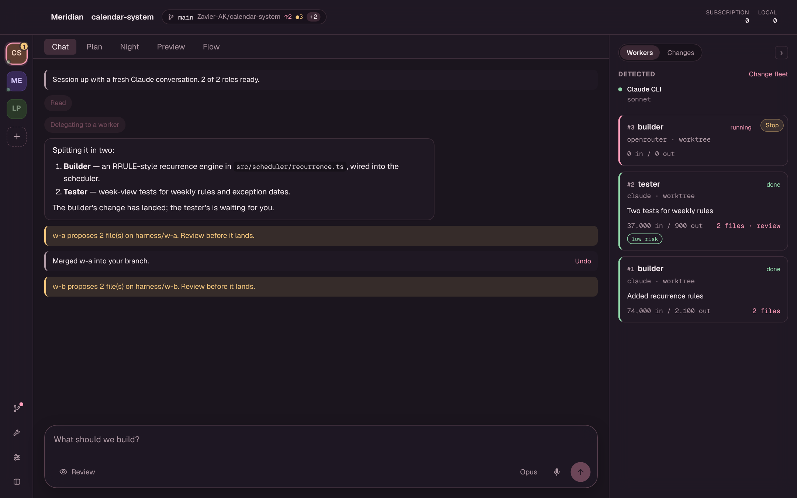
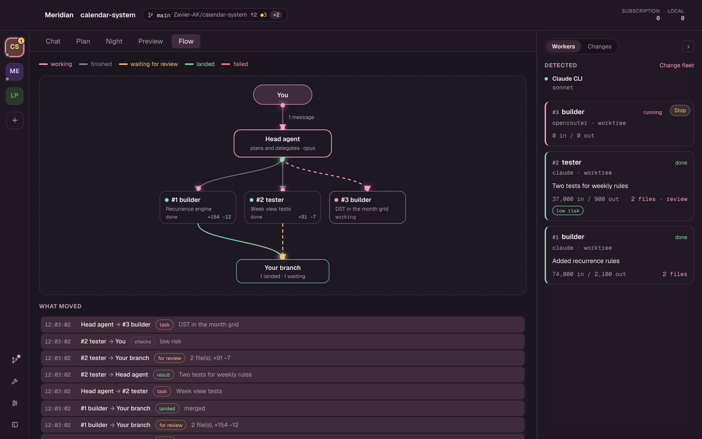
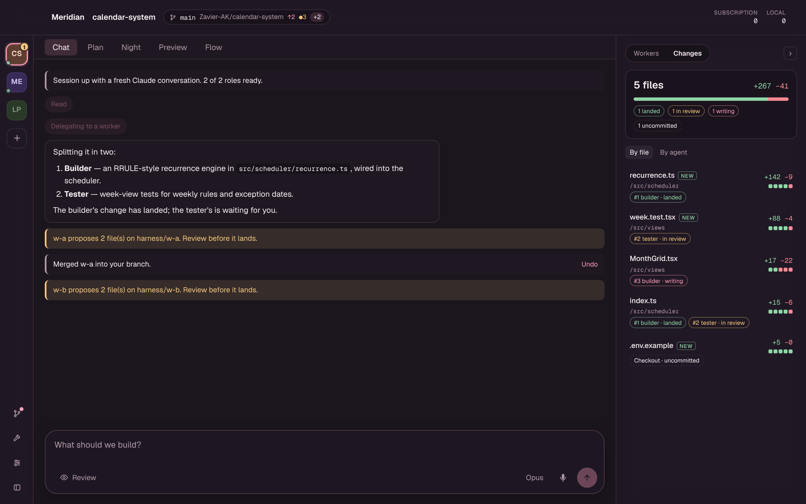
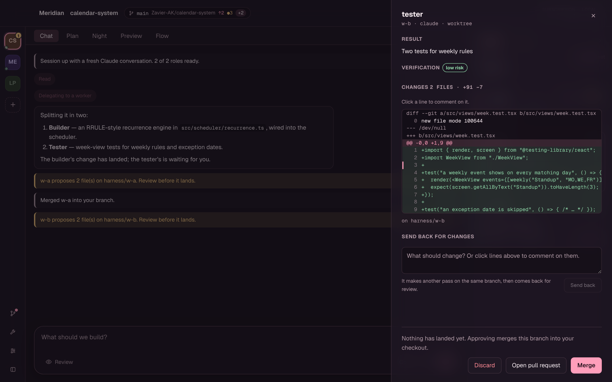
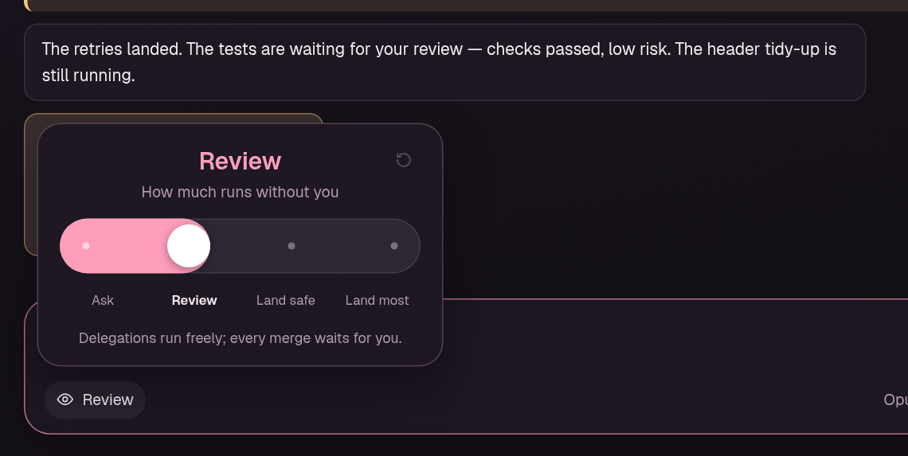
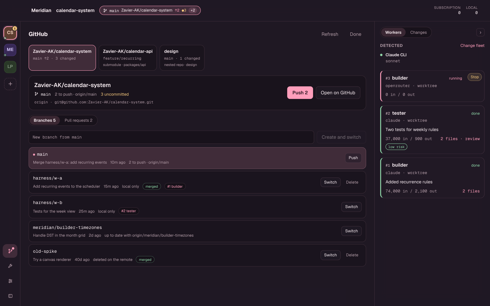

# Meridian

**A Mac app for running a team of coding agents on the subscriptions you already pay for.**

A head agent plans and delegates; workers build in their own git worktrees, in parallel;
nothing touches your code until you've reviewed it. Every agent is the vendor's own CLI —
`claude`, `codex` — or a local model, so the work runs on Claude and ChatGPT subscriptions
instead of API billing, and local models cost nothing.



## What it does

- **Delegates in parallel.** Ask for a change; the head agent splits it up and hands the
  pieces to workers — builders, testers, reviewers — each in its own worktree on its own
  branch. Claude, Codex and local models (Ollama, LM Studio) can all be workers, and so can
  any [OpenRouter](docs/GUIDE.md#openrouter) model, on a per-token key.
- **Nothing lands without review.** Every change is checked (your tests, an AI reviewer)
  and given a risk level. Then merge it (with undo), discard it, comment on its lines and
  **send it back** for another pass, or **open a pull request**.
- **Shows the whole picture.** The **Flow** tab maps who's working on what and what's
  moving between them; the **Changes** panel lists every file touched, with lines added and
  removed.
- **Keeps git in view.** The title bar shows the branch and repository you're on. One click
  opens every repository the project spans, with its branches and open pull requests:
  push, switch, clean up merged branches, or hand a pull request to an agent to review.
- **You choose how much runs alone.** A slider, from *Ask* (every step waits for you) to
  *Land most* (verified, low-risk changes land by themselves).
- **Plans and night shifts.** Multi-step work goes on a plan board you approve first. A
  night shift runs experiments overnight and keeps only the ones that improve a metric.
- **Talk to it.** Hold ⌥Space anywhere: "what's waiting for me?", "merge the builder's
  change", "find me a cheaper flight". Web tasks run in their own browser and always ask
  before sending, buying or posting.
- **Asks before it acts.** The head agent can only read and delegate; a command or file
  change it wants is put to you with Allow / Always allow / Deny.

<table>
  <tr>
    <td width="50%"></td>
    <td width="50%"></td>
  </tr>
  <tr>
    <td><b>Flow</b> — who's doing what, and what's moving between them.</td>
    <td><b>Changes</b> — every file touched this session, by file or by agent.</td>
  </tr>
  <tr>
    <td width="50%"></td>
    <td width="50%"></td>
  </tr>
  <tr>
    <td><b>Review</b> — comment on lines and send it back, merge, or open a PR.</td>
    <td><b>Autonomy</b> — how much runs without you.</td>
  </tr>
  <tr>
    <td colspan="2"></td>
  </tr>
  <tr>
    <td colspan="2"><b>GitHub</b> — every repository the project spans, its branches and pull requests.</td>
  </tr>
</table>

## Getting started

You need Rust, Node 20+, `git`, and `cmake` for voice (`brew install cmake`). Install the
agent CLIs you want and sign in: `claude` (`claude auth login`), `codex` (`codex login`),
and optionally Ollama or LM Studio for local models.

```bash
git clone https://github.com/Zavier-AK/Meridian.git && cd Meridian
cd app && npm install && npm run tauri dev
```

Pick a project folder and press **Start session**. If the folder isn't a git repository
or has no fleet (`roles.toml`) yet, the start screen offers to set both up. After pulling
updates, run `npm install` in `app/` again.

Prefer a terminal? The same engine runs headless:

```bash
cargo run -p harness-cli -- roles                       # your fleet, and what's reachable
cargo run -p harness-cli -- chat "Plan the change, then delegate it."
```

## How it works

```
Meridian (Tauri + React)
└── harness-core — the engine, no GUI
    ├── head agent: one long-lived `claude` process with delegation tools (MCP, loopback only)
    ├── workers: claude │ codex │ local models │ OpenRouter — each in a git worktree, read-only checkout, or none
    ├── checks: your commands + an AI reviewer → a risk level per change
    └── SQLite: sessions, runs, events, usage
```

The head agent is a single `claude` process for the whole conversation, so its context is
paid for once, not on every message (measured: turn 1 created 39,306 cached tokens, turn 2
just 906). API keys are stripped from every agent's environment, so they always use their
CLI's subscription sign-in. The one exception is a role you put on OpenRouter, which gets
your OpenRouter key and nothing else.

## More

- **[The full guide](docs/GUIDE.md)** — every feature in detail:
  [delegation](docs/GUIDE.md#delegation),
  [verification](docs/GUIDE.md#verification-before-merge),
  [sending work back and pull requests](docs/GUIDE.md#sending-work-back-and-pull-requests),
  [branches and repositories](docs/GUIDE.md#repositories-branches-and-pull-requests),
  [the plan board](docs/GUIDE.md#the-plan-board),
  [night shift](docs/GUIDE.md#night-shift),
  [autonomy](docs/GUIDE.md#how-much-runs-without-you),
  [voice](docs/GUIDE.md#talk-to-it),
  [local models](docs/GUIDE.md#attaching-a-local-model),
  [OpenRouter](docs/GUIDE.md#openrouter),
  [sign-in problems](docs/GUIDE.md#when-claudes-sign-in-fails).
- **[Project status](docs/STATUS.md)** — what's verified, what isn't, and what's next.

Formerly *local-harness*: the crates and on-disk names (`.harness/`, `harness/…` branches)
keep the old name so existing projects carry on working.

## Credits

Skills in [`skills/`](skills/) are adapted from
[David Ondrej's agent skills](https://github.com/davidondrej/skills) (MIT); see
[`skills/NOTICE.md`](skills/NOTICE.md). Voice uses
[whisper.cpp](https://github.com/ggml-org/whisper.cpp) via
[whisper-rs](https://codeberg.org/tazz4843/whisper-rs),
[Laya](https://huggingface.co/convaiinnovations/laya) (Apache 2.0) via
[`@receptron/laya`](https://github.com/receptron/laya), and
[Kokoro](https://huggingface.co/onnx-community/Kokoro-82M-v1.0-ONNX) for its voice.
